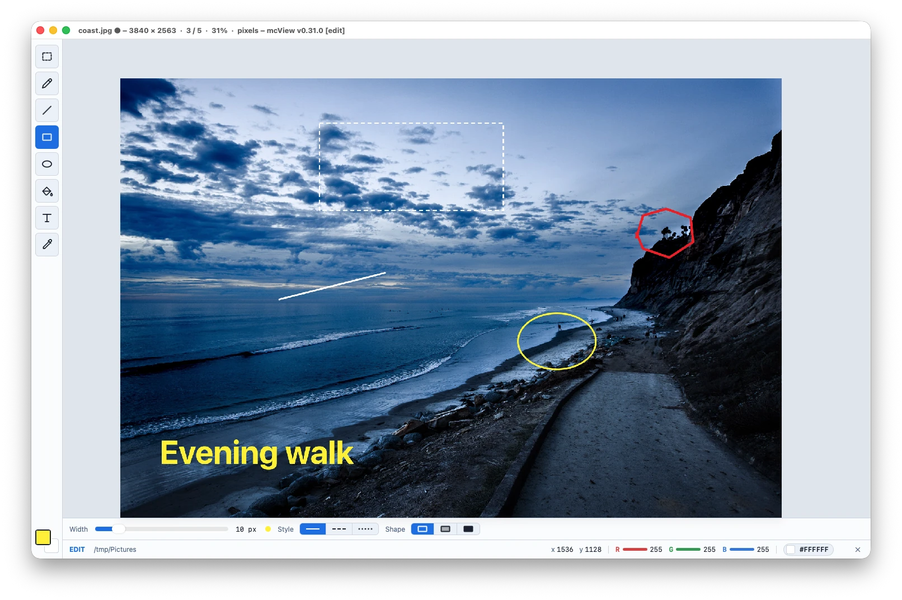
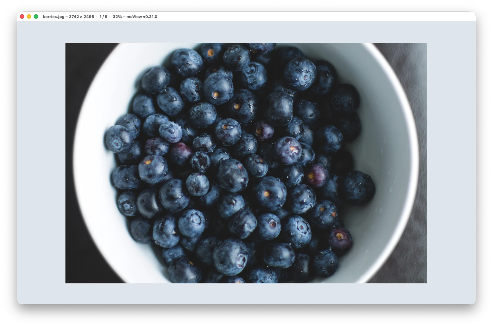
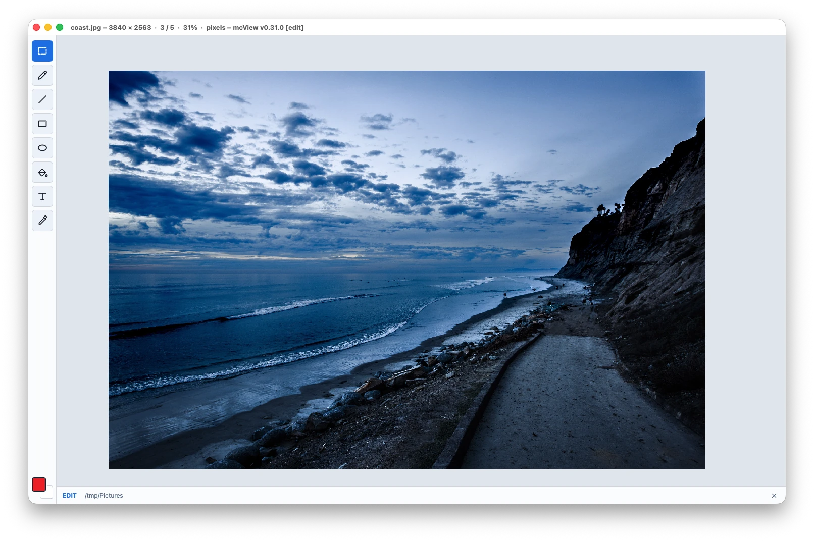
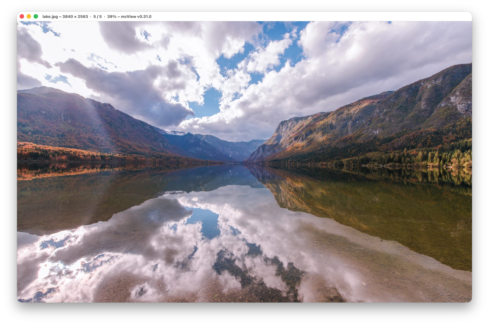
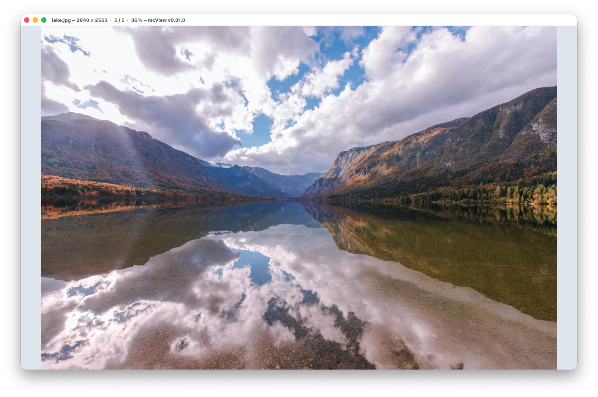
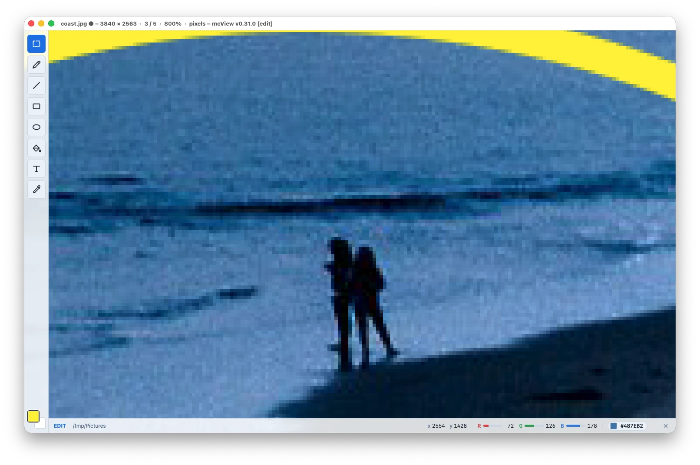
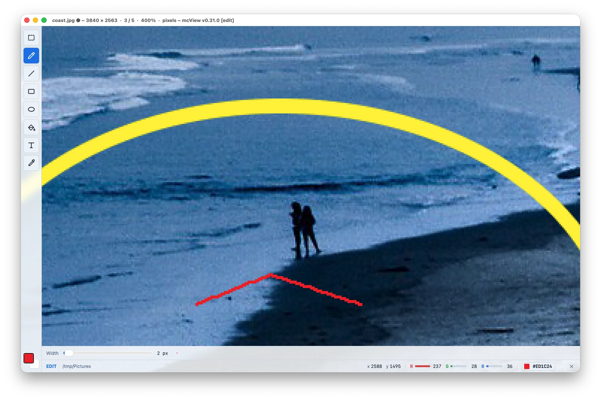
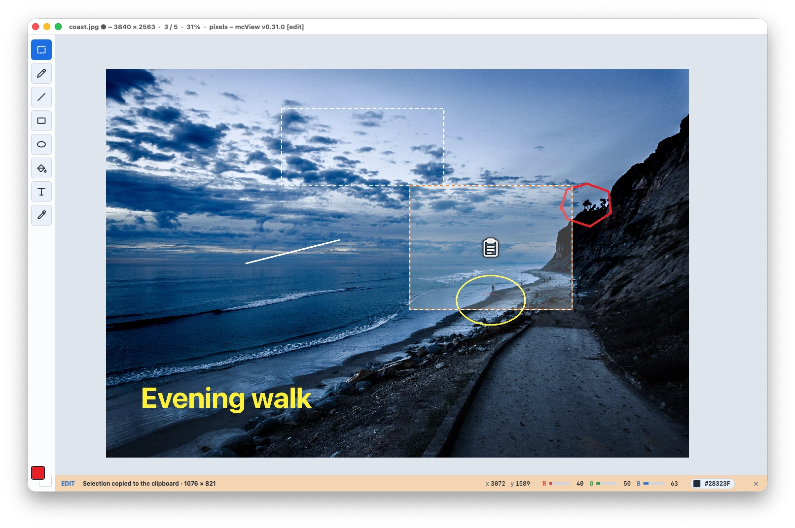

<h1 align="center">mcView</h1>

<p align="center">
  <b>A picture viewer, with a small Paint-like editor, for macOS, Windows and Linux.</b><br>
  Early preview: it is offered in Open with… for your pictures, edit mode (key <b>E</b>) draws, types and pastes on them, and a built-in chat (key <b>C</b>) lets Claude change them for you.
</p>

<p align="center">
  <a href="https://github.com/mormitech/mcview/actions/workflows/build.yml"></a>
  <a href="LICENSE"></a>
  
  
</p>

---

<p align="center"></p>

## What it does

mcView shows a picture quickly and stays out of the way, like [IrfanView](https://www.irfanview.com). Press **E** and the same window becomes a
small editor in the way of Paint: select (a rectangle or free-hand), move and stretch parts, draw, type, paste, save. Press **C** and you can also just tell Claude what to change in the picture. It is built the same way as
[mcPrint](https://github.com/mormitech/mcprint): Go and [Wails](https://wails.io) v2 for the window, a vanilla JS frontend built with Vite.
The manual is [docs/help.md](docs/help.md), also at [mormitech.com/tools/mcview/docs](https://mormitech.com/tools/mcview/docs) (Help → mcView Help opens it).

Below, **Ctrl** is **Cmd** on a Mac.

### Screenshots

| | |
|---|---|
| <br>**Viewing.** The title says the size, the place in the folder (`1 / 5`) and the zoom. | <br>**Edit mode** (**E**): the tool rail, the two colors, the pixelated view and the pixel readout. |
| <br>**Zoom mode 5**: the side edges touch the window. | <br>**Zoom mode 6**: the top and bottom edges touch it. |
| <br>**Zoom to investigate.** At 800% every pixel is a square, and the bar shows the pixel under the pointer: x and y, R G B and the hex color. | <br>**Zoom to draw exactly.** A 2 pixel pencil at 400% puts every pixel where you want it. |
| <br>**Colors.** Click a color well and the palette slides up; Edit colors… opens the system's picker. | <br>**Selections** are on the clipboard the moment you let go, with a short highlight and their size. |

The sample picture is a free (CC0) photo from Unsplash, via Wikimedia Commons. The screenshots are made by [`scripts/demo_screenshots.py`](scripts/demo_screenshots.py) with mcView's [control mode](docs/control.md).

### Viewing

- **Shows pictures.** JPEG, PNG, GIF, BMP, WebP, ICO, SVG, AVIF and TIFF (AVIF and WebP need a web view that has them; TIFF is
  decoded by mcView itself, so it also works on Windows and Linux).
- **Zoom modes** on the keys **1** to **4**, as in IrfanView; the mode stays when you go to another picture and until you quit (a new window starts in **2**):
  **1** original size (100%, however small or big), **2** fit the window with a margin (85%; small pictures stay 100%), **3** fit every picture to
  the window borders, keeping its proportions, **4** stretch every picture to the window borders, **5** zoom until the side edges touch the window (the top and bottom may go over), **6** zoom until the top and bottom edges touch it (the sides may go over). **+** and **-** zoom, a mouse wheel zooms, dragging
  moves the picture (a double click never changes the zoom); on a Mac two fingers on the trackpad move the picture and a pinch zooms. Pull a big picture past its edge and it gives a little, then eases back.
- **Arrow keys** (Space for next, Backspace for previous) go through the pictures of the folder in alphabetical order, and go round. The title of the window
  says the size, the place in the folder (`3 / 5`) and the zoom.
- **Rotate the view.** **R** turns the picture a quarter clockwise, **Shift+R** counterclockwise. Only the view turns; the file is not changed until you save.
- **Full screen.** **F** or **Enter** toggles it (Esc does not leave it: two Escs close the picture). There is no title or bar then: the bar (size, place, zoom, color readout) comes up
  when the pointer is at the bottom edge, or while there is a selection.
- **Pixel view and color readout.** In edit mode the picture is shown pixelated (every pixel a sharp square) and the bar shows the pixel under the pointer: its x and
  y, R G B (A) with meters, and the hex color in a pill. The numbers are the ones in the file (mcView decodes it itself, with no color conversion), except for AVIF, SVG and ICO,
  where they are read from what the web view drew and the bar says so.
- **Transparency.** A picture with transparent parts has chequered squares behind it.
- **Select and copy.** Drag to select a part (it snaps to whole pixels in the pixelated view). The moment you let go, the selection is **on the clipboard**,
  with a short highlight and its size written in the middle. With no selection, **Ctrl+C** copies the whole picture. **Esc** or a click takes the selection away.
  On Linux copying and pasting pictures needs `xclip` (X11) or `wl-clipboard` (Wayland).
- **Paste as a new picture.** Outside edit mode, **Ctrl+V** makes the clipboard picture the picture of the window (undo brings the one before back). Open a new window
  (**Ctrl+N**) to keep both.
- **Home screen.** A window with no picture offers three big buttons: **Open file…** (key **O**), **Open from clipboard** (**Ctrl+V**, shown when there is a picture on it) and **Create image** (**N**). **O** and **N** work with a picture open too; a picture with unsaved changes asks Save, Discard or Cancel first.

### Editing (edit mode)

**E** (or **Tab**) turns edit mode on and off; the title says `[edit]`, the bar says `EDIT`, and the tool rail (Select, Polygon select, Pencil, Line, Rectangle, Ellipse, Fill, Text, Pick) and the bottom bar appear. The **✕** at the bottom right closes the picture. Edit mode needs a picture:
**File → Create Image** makes a new white 1280 × 720 one and starts it in edit mode; **hold Shift** (or press **Shift+N**) to choose the size and the background first. A blank image, and a picture pasted from the clipboard, count as unchanged: they close without a question until you do something to them.

- **Select** (default): drag an edge or the inside of the selection to move or resize just the frame; hold **Shift** and drag to stretch or move the selected part itself; the place it came from turns white
  (transparent in a picture that can have it). **Shift** and drag moves just the frame. **Ctrl+V** lays the clipboard picture over this one as a floating part you can drag and stretch
  (Delete, Backspace or Esc take it away; a click beside it lays it down).
- **Polygon select**: draw round any shape free-hand; when you let go, the end joins the start and mcView turns the line into a polygon (a few corners, within about a pixel of what you drew). Holding the **right mouse button** does the same with the Select tool. **Delete** fills it with the second color, **Ctrl+C** copies what is inside it, **Esc** lets it go (Esc or a right click drops a selection that is still being drawn, the rectangle too).
- **Pencil**: drag to draw; left button the first color, right button the second. The ribbon above the bottom bar sets the width.
- **Line** and **Rectangle**: drag them out; **Shift** makes a line at a multiple of 45° and a square. The ribbon sets the width, a solid, dashed or dotted style and, for the rectangle,
  outline, outline with fill, or fill. **Esc** or the other mouse button drops one that is being dragged.
- **Circle and ellipse**: drag the box of the ellipse; **Shift** makes a true circle. The ribbon has the same width, style and outline/fill choices as the rectangle.
- **Fill** (the paint bucket): click fills the area of the same color with the first color, right click with the second. The ribbon has a tolerance: 0% fills exactly that color, more takes in colors that are close (good for photos and soft edges).
- **Text**: click, type, click elsewhere to put it in (**Ctrl+Enter** also does, **Esc** drops it). Font, size, bold and italic are in the ribbon.
- **Pick**: click takes the color under the pointer as the first color (right click: the second), then the tool you had comes back.
- **Colors**: the two wells at the bottom of the rail are the first and second color; click one for the palette (or *Edit colors…* for the system's picker).
- **Undo and redo.** **Ctrl+Z** / **Ctrl+Shift+Z** (Ctrl+Y). Every change of the picture, the mode (1–6), the pixelated view, the turn and the arrow keys can be undone; zooming, moving and the selection are not steps.
- **Discard Changes** (File menu, or the round-arrow button in the edit bar) takes the picture back to what it was when it came into the window; undo brings the changes back.
- Nothing is written to the file until you save. A picture with changes has a ● after its name.

### Chat with Claude

**C** (or the speech bubble at the top right) opens a chat panel next to the picture. It runs the [Claude Code](https://claude.com/product/claude-code) that is installed on your computer, with your Claude subscription (no API key; the panel offers **Sign in with Claude**, which opens the browser). Ask for what you want: draw, remove a label or a stain, crop, make pixel art, or *"remove the selected part"* after you selected something. Claude looks at the picture and changes it with mcView's tools, piece by piece, and every change can be undone. Claude gets the picture tools and web search and fetch, and nothing else (no files, no shell), and the chat is the one place where a picture leaves your computer, only when you ask. See [docs/help.md](docs/help.md#chat-with-claude) and, for how it works, [docs/chat.md](docs/chat.md).

### Saving, closing, deleting

- **S** (Ctrl+S, File → Save As…) saves PNG, JPEG, GIF, BMP or TIFF. For a picture from a file that has changes it first asks **Overwrite**, **Save As** (the dialog offers the name with the date and time added, `photo-20261026-153012.jpg`) or **Cancel**.
  With a selection, **S** saves just the selection as a picture of its own. Saving to another folder makes that folder the one the window works in. A picture with transparent parts is offered as PNG.
- **Closing** a picture with changes asks **Save**, **Discard** or **Cancel**, whether by **Ctrl+W** (closes the picture, or the window when there is none), **Esc Esc** (two presses within a quarter of a second; on the home screen it asks whether to quit), the **✕**,
  going to another picture, or closing the window. File → Close Image (**Ctrl+Shift+W**) closes just the picture.
- **D** (File → Delete Image…) asks, then deletes the file and shows the next picture of the folder. On a Mac the file goes to the Trash; on Windows and Linux it is deleted for good.
- **File → Open…** (**Ctrl+O**, or just **O**) opens a picture; a second picture from the file manager gets a window of its own.

### Everywhere

- **Open with… offers mcView.** [See below](#open-with). No code signing needed.
- **One window, three systems.** The same code builds for macOS, Windows and Linux; the window is cut down to 90% of the screen at start and its place is remembered.
- **An About window and a Help menu.** *mcView → About mcView* on macOS, *Help → About mcView* on Windows and Linux; *Help → mcView Help* opens the manual.
- **Follows your system.** Light or dark mode.
- **Tests and CI.** Builds, vets and tests on macOS, Windows and Linux, and packages the app on a release tag.

## Install

Download the package for your system from the [releases](https://github.com/mormitech/mcview/releases):

| | Package |
|---|---|
| **macOS** (Apple silicon) | `mcview-<version>-macos-arm64.dmg` (open it and drag mcView to Applications), or the `.zip` with the app |
| **Windows** (x64) | `mcview-setup-<version>-windows-x64.exe` (per user, no admin rights), or the `.zip` |
| **Linux** (x64) | `mcview-<version>-linux-amd64.deb` (Debian, Ubuntu: `sudo apt install ./mcview-….deb`), `mcview-<version>-linux-x86_64.rpm` (Fedora, openSUSE: `sudo dnf install ./mcview-….rpm`), or the `.tar.gz` with `install.sh` |

The app is not code-signed or notarized yet, so macOS asks you to confirm the first start (right-click → Open). Or build it yourself (below).

<a id="open-with"></a>
## Open with…

mcView is offered for the picture types above. It does not take them over from your current viewer: you choose it.

| | How |
|---|---|
| **macOS** | Right-click a picture → **Open With** → mcView. To make it the default for a type: **Get Info** → **Open with** → mcView → **Change All…**. The app must be in Applications (or have been opened once) for macOS to know it. |
| **Windows** | Right-click a picture → **Open with** → mcView (the first time **Choose another app**). To make it the default: **Settings → Apps → Default apps → mcView**. The installer adds this per user, without admin rights. |
| **Linux** | The .deb and .rpm do this by themselves. From the tar.gz, run `./install.sh` (`./install.sh --remove` undoes it). Then right-click a picture → **Open With** → mcView. |

The list of types is written in four places, because each system wants it in its own form: `image.go`, `wails.json` (macOS Info.plist),
`packaging/windows/installer.iss` and `packaging/linux/mcview.desktop`. A test keeps them equal.

## Develop

```
cd frontend && npm install && cd ..
wails dev          # live-reloading window
go vet ./... && go test ./...
wails build        # the app ends up in build/bin
```

You need [Go](https://go.dev), Node and the [Wails](https://wails.io) CLI (`go install github.com/wailsapp/wails/v2/cmd/wails@latest`).
On Linux also `libgtk-3-dev libwebkit2gtk-4.1-dev`, and build with `-tags webkit2_41`. The Go code embeds the built frontend, so run
`npm run build` in `frontend` before `go vet` and `go test`.

| Path | What |
|---|---|
| `main.go`, `about.go` | the window, the menus per system, the `--about` window |
| `window.go` | the screen-size gate: `fitSize` and `fitWindow` |
| `app.go` | the methods the UI calls (the version, the window mode, Open…) and the extra windows |
| `chat.go`, `mcp.go`, `shapes.go`, `canvas.go`, `masks.go`, `retouch.go`, `pixels_edit.go`, `saveto.go` | the chat panel (Claude Code in the background, signing in), the private tool server of a window and its tools, and what the tools do to the picture: shapes, canvas and crop, masks, clone, blend and fill |
| `revert.go` | Discard Changes |
| `float.go`, `layer.go`, `fill.go`, `selection.go`, `selsave.go` | the lifted and moved part, the pencil stroke, a drawn line, rectangle, ellipse or text put into the picture, the paint bucket, the selection |
| `clip.go`, `save.go`, `overwrite.go`, `discard.go`, `delete.go` | the clipboard and new images, Save As and its questions, unsaved changes, deleting |
| `undo.go` | the history of picture states |
| `image.go` | the picture types, opening a file (command line and the macOS open-file event), serving the picture to the web view |
| `frontend/` | the UI (vanilla JS, built with Vite) |
| `build/` | icons, macOS Info.plist, Windows manifest and version info |
| `packaging/windows` | the Inno Setup installer script, with the Open with… registry entries |
| `packaging/linux` | the desktop entry and `install.sh` (the .deb and .rpm are made by the workflow with fpm) |
| `.github/workflows/build.yml` | builds, tests and packages on macOS, Windows and Linux; publishes the release on a tag |

The window has one process per window (Wails v2): the About window is the same program started with `--about` (or with a picture: `mcview picture.jpg`). `--theme dark` (or `light`)
forces the look instead of the system's.

**Control mode.** `mcview --control 0 picture.jpg` lets another program drive every feature (menus, tools, shapes, fills, selections and text in picture pixels, zoom,
the answers of the dialogs) over a local, token-protected connection: for demo screenshots and scripted tests. See [docs/control.md](docs/control.md);
`scripts/demo_screenshots.py` makes the screenshots of the manual that way.

**Chat panel.** The speech bubble at the top right of a picture window (or the key **C**) opens a chat with Claude about the picture, and Claude can change it with picture tools: snapshots, drawing, fills, selecting, clone and healing patches, masks, resizing and cropping. It runs the Claude Code on the computer with the user's subscription (no API key), signs in through the browser, and reaches the picture through a private tool server that exists only for this window. See [docs/chat.md](docs/chat.md).

**Effects.** The Effects menu applies blur, pixelize, emboss, explosion, censor, sharpen, grayscale, negative, sepia and brightness, contrast, color and warmth adjustments to the selected part (a box or a free-hand polygon) or to the whole picture; the chat's Claude can apply them too, with settings. **Polygon select.** In edit mode the second tool of the rail selects freely: draw round the part with the mouse, and when you let go the end is joined to the start and mcView turns the line into a polygon (a few corners, within about a pixel of what you drew). Delete fills it with the second color, Ctrl+C copies what is inside it, Esc lets it go. **File → Discard Changes** (also a button in the edit bar) takes the picture back to its original, and undo brings the changes back.

**Slow start?** Start the app with `MCVIEW_TRACE=/tmp/mcview-trace.txt` (macOS: `open --env MCVIEW_TRACE=/tmp/t.txt -a mcview.app picture.jpg`): each step of the
start, in Go and in the UI, is written to that file with a time in milliseconds.

**Versioning.** The version lives in one place, `wails.json` (`info.productVersion`). It feeds the macOS Info.plist, the Windows file
properties, the window title and the About window. A release is cut by pushing a `v*` tag that matches it; CI checks that, builds the
packages and attaches them to a GitHub release.

## License

[MIT](LICENSE): use it, change it, ship it, forever.
